# CLYVO Elo — Mobile

Aplicativo em **React Native com Expo** do **CLYVO Elo**, a solução do nosso grupo para o Challenge FIAP 2026 proposto pela **CLYVO VET**. Este repositório é a entrega final da disciplina de **Mobile Application Development (Sprint 4)**.

- **Publicação:** Firebase App Distribution (Android), com o e-mail institucional do professor cadastrado como tester
- **Vídeo de apresentação:** [a preencher]
- **API consumida:** https://clyvoelo-dotnet.onrender.com/swagger ([repositório](https://github.com/GabrielCabralmm/ClyvoElo-dotnet))

## Integrantes

| Nome | RM | Turma |
|---|---|---|
| Gabriel Cabral Mendes Mariano | RM563230 | 2TDSPO |
| João Victor Santana dos Santos | RM566063 | 2TDSPX |

---

## 1. O problema e a solução

O tutor costuma procurar a clínica só quando o pet já está doente. Entre uma consulta e outra, o vínculo esfria: a segunda dose da vacina é esquecida, o pós-operatório é abandonado no meio e a orientação do veterinário se perde.

O **CLYVO Elo** mantém esse vínculo ativo depois da consulta:

- o **doutor** registra cada cuidado (vacina, check-up, pós-operatório, medicação, exame), com a data prevista, e envia **orientações escritas** direto para o tutor do pet;
- o **tutor** acompanha os pets, vê a agenda e o histórico de cuidados e **recebe uma notificação** quando o doutor envia uma orientação ou agenda um novo cuidado, além de um **lembrete no dia** de cada cuidado.

## 2. Perfis

| Ação | Tutor | Doutor |
|---|---|---|
| Ver os próprios pets, com busca | Sim | — |
| Ver todos os pacientes, com busca e nome do tutor | — | Sim |
| Cadastrar pet, atualizar peso, excluir pet | Sim | — |
| Ver a agenda e o histórico de eventos clínicos | Sim | Sim |
| Registrar evento (tipo e data), alternar status, excluir | — | Sim |
| Enviar orientação ao tutor de um pet | — | Sim |
| Ler orientações (marcadas como lidas automaticamente) | Sim | — |
| Ver as mensagens enviadas e se o tutor já leu | — | Sim |
| Receber notificações e lembretes | Sim | — |
| Tema claro/escuro, Sobre o App, sair | Sim | Sim |

### Acessos de demonstração

| Perfil | Email | Senha |
|---|---|---|
| Tutor | gabriel@email.com | clyvo123 |
| Doutor | ana.ferreira@clyvovet.com | clyvo123 |

Também é possível criar uma conta de tutor pela tela de cadastro.

## 3. Telas

| Tela | Rota | O que faz |
|---|---|---|
| Login | `/(auth)/login` | Entrar como Tutor ou Doutor |
| Cadastro | `/(auth)/cadastro` | Criar conta de tutor |
| Início | `/(tabs)` | Tutor: meus pets. Doutor: todos os pacientes. Busca e rolagem infinita paginada |
| Mensagens | `/(tabs)/mensagens` | Tutor: orientações recebidas, com contador de não lidas na aba. Doutor: mensagens enviadas |
| Perfil | `/(tabs)/perfil` | Dados da conta, tema (Sistema, Claro, Escuro), notificações, Sobre o App e sair |
| Detalhe do pet | `/pet/[id]` | Dados, idade, peso editável pelo tutor, atalhos para eventos e orientações, exclusão |
| Novo pet | `/pet/novo` | Cadastro com nome, espécie, raça e peso |
| Eventos clínicos | `/eventos/[idPet]` | Agenda e histórico, com situação (pendente, concluído, atrasado) |
| Novo evento | `/eventos/novo` | Doutor escolhe o tipo, a data (hoje, amanhã, 7, 15 ou 30 dias) e a descrição |
| Mensagem | `/mensagens/[id]` | Orientação completa, pet, doutor e status de leitura |
| Nova orientação | `/mensagens/nova` | Doutor escolhe a categoria, o assunto e o texto |
| Sobre o App | `/sobre` | Versão, **hash do commit da versão publicada**, canal do build, API e equipe |

| | | | |
|---|---|---|---|
| 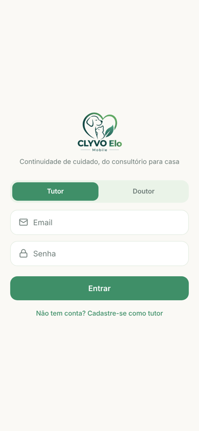 | 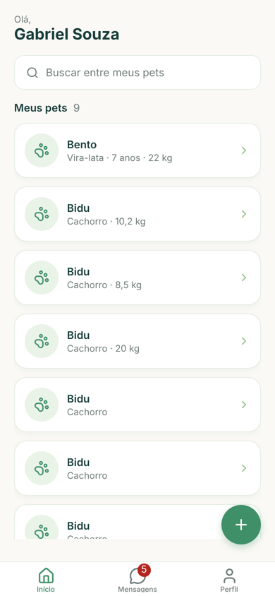 | 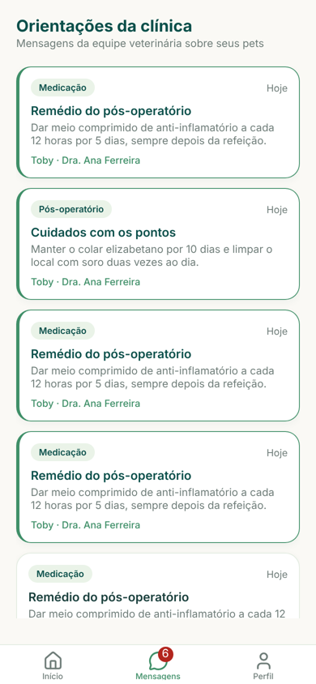 | 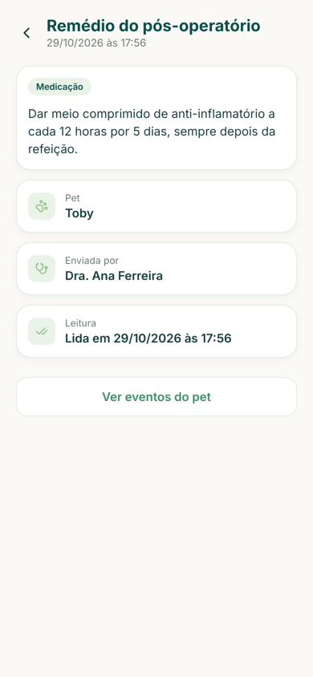 |
| Login | Início do tutor | Orientações recebidas | Orientação lida |
| 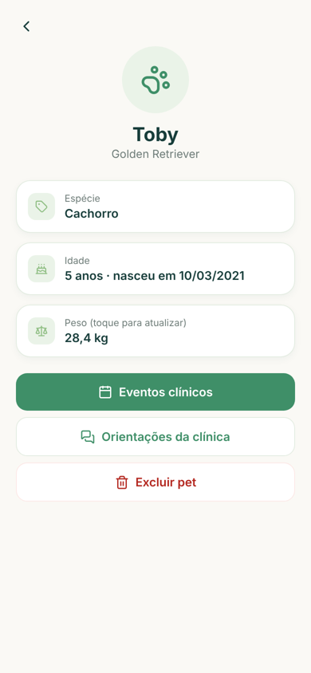 | 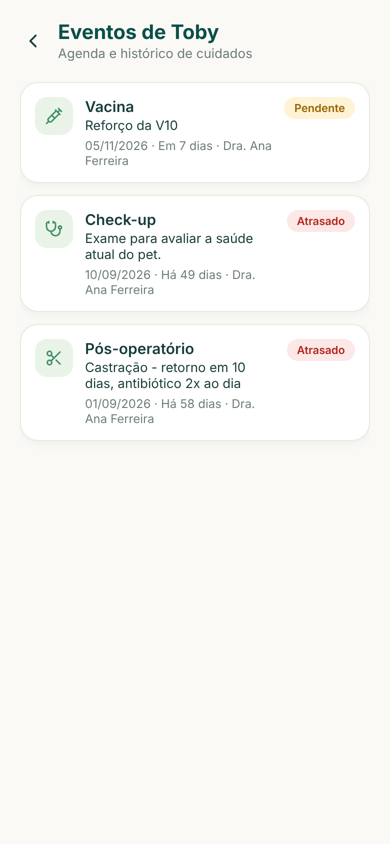 | 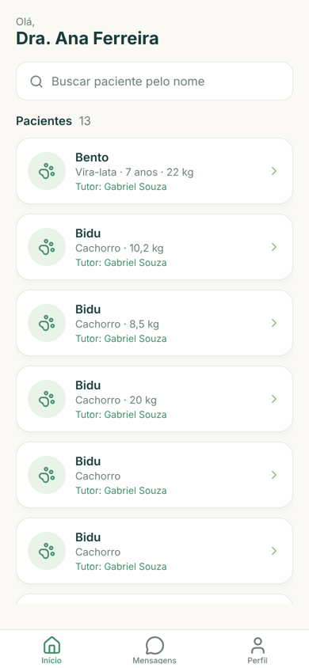 | 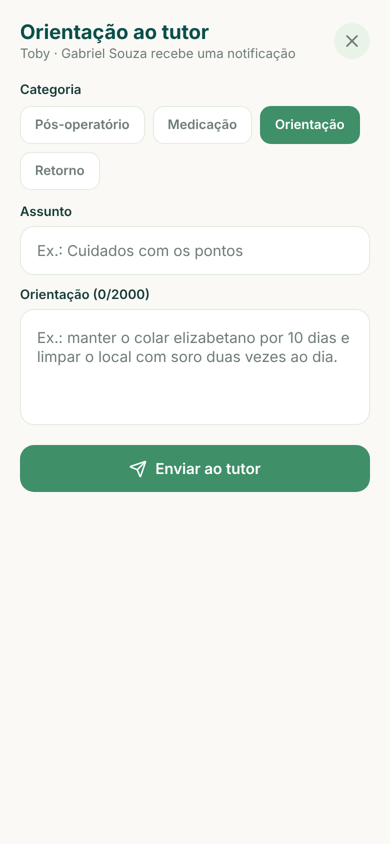 |
| Detalhe do pet | Eventos clínicos | Pacientes do doutor | Nova orientação |
| 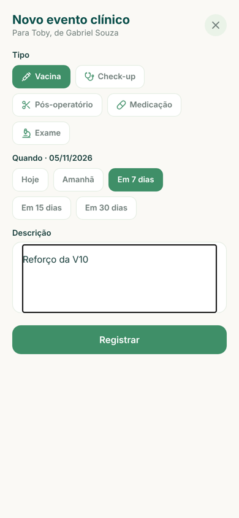 | 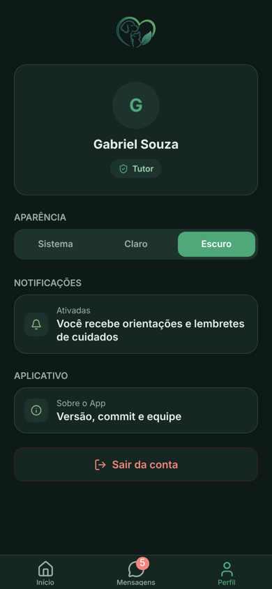 | 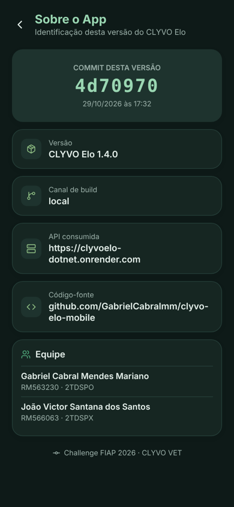 | 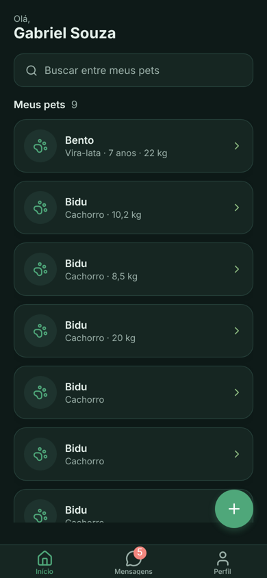 |
| Novo evento | Perfil no tema escuro | Sobre o App | Início no tema escuro |

## 4. Notificações (locais)

O app usa **notificações locais** com `expo-notifications`, disparadas por **eventos reais do sistema**. Nada é simulado nem disparado por botão.

| Cenário | Evento gerador | O que o tutor recebe | Ao tocar |
|---|---|---|---|
| **Nova orientação do doutor** | O doutor envia uma mensagem pelo app (gravada no MongoDB da API .NET) | "Dra. Ana Ferreira enviou uma orientação — Toby: Cuidados com os pontos" | Abre a mensagem, que é marcada como lida |
| **Novo cuidado agendado** | O doutor registra um evento clínico pendente para o pet | "Novo cuidado agendado para Toby — Vacina em 05/11/2026 com Dra. Ana Ferreira" | Abre os eventos do pet |
| **Lembrete no dia do cuidado** | Existe um evento pendente com data futura | Às 9h do dia: "Hoje: vacina de Toby" (agendada no aparelho, chega mesmo com o app fechado) | Abre os eventos do pet |

Como funciona, em `src/hooks/useCentralDeAvisos.ts`:

1. Com o tutor logado, o app consulta a API a cada 30 segundos (mensagens não lidas) e a cada 60 segundos (eventos dos pets), usando o `refetchInterval` do TanStack Query.
2. A regra em `src/domain/avisos.ts` compara o que chegou com o que já foi avisado (registro salvo no aparelho por usuário). Só o que é realmente novo vira notificação. No primeiro acesso, o histórico antigo é registrado sem gerar avisos.
3. Os lembretes dos eventos pendentes são reagendados a cada sincronização. Se o doutor concluir, excluir ou mudar a data do evento, o lembrete acompanha.
4. Ao tocar na notificação, `useAberturaPorNotificacao` abre a tela relacionada.
5. Com o app aberto, a notificação aparece como banner. No Android ela usa o canal "Cuidados do pet", com prioridade alta.

## 5. Arquitetura

As responsabilidades ficam separadas em camadas. As telas não fazem chamadas HTTP nem guardam regra de negócio.

```
src/
  app/            telas (Expo Router): só montam a interface e chamam hooks
    (auth)/       login, cadastro
    (app)/        área logada
      (tabs)/     início, mensagens, perfil
      pet/        detalhe, novo
      eventos/    agenda do pet, novo evento
      mensagens/  detalhe, nova orientação
      sobre.tsx   Sobre o App
  components/     componentes reutilizáveis (Tela, Cabecalho, Botao, CampoTexto, Seletor, Cartao, Etiqueta...)
  hooks/          hooks do TanStack Query por recurso (usePets, useEventos, useMensagens),
                  central de avisos, permissão de notificação, estilos com tema
  services/       acesso à API: cliente HTTP com JWT e um serviço por recurso
  domain/         regras de negócio puras: validações, situação do evento, datas, montagem dos avisos
  contexts/       AuthContext (sessão) e TemaContext (claro/escuro)
  lib/            armazenamento seguro, sessão, notificações (nativo e web) e registro de avisos
  config/         dados da tela Sobre o App
  theme/          paletas clara e escura
  types/          tipos que espelham os DTOs da API
```

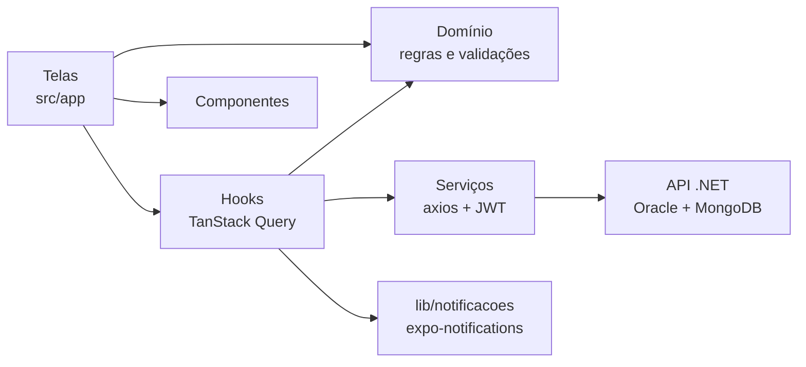

Decisões principais:

- **TanStack Query isolado da interface.** Toda consulta e mutação fica em `src/hooks`, com chaves centralizadas em `chavesDeConsulta.ts`. As mutações invalidam só o que muda: excluir um evento atualiza a lista daquele pet.
- **Paginação real da API.** As listas usam `useInfiniteQuery` com a paginação da API .NET (`pagina` e `tamanhoPagina`) e carregam a próxima página ao chegar no fim.
- **Erros da API mostrados ao usuário.** `domain/erros.ts` lê o `ProblemDetails` da API (por exemplo, "O peso não pode passar de 150 kg") e trata a falta de conexão.
- **Sessão expirada.** O interceptor do axios desloga sozinho quando a API responde 401.
- **Tema claro e escuro.** `TemaContext` segue o tema do sistema por padrão, permite escolher Claro ou Escuro no Perfil e guarda a preferência. Todas as telas montam os estilos com a paleta ativa (`useEstilos`).
- **Uma implementação por plataforma.** `lib/notificacoes.ts` (Android e iOS) e `lib/notificacoes.web.ts` (navegador) expõem as mesmas funções, e o restante do app não sabe em qual plataforma está.

## 6. Versão publicada e tela "Sobre o App"

O `app.config.js` grava no app o **hash do commit** usado no build. No EAS Build, ele vem da variável `EAS_BUILD_GIT_COMMIT_HASH`; localmente, vem de `git rev-parse HEAD`. A tela **Sobre o App** (Perfil → Sobre o App) mostra esse hash, a data do commit, a versão (`1.4.0`) e o canal do build. Tocar em "Código-fonte" abre o commit no GitHub. Assim dá para conferir que o APK instalado corresponde ao código do repositório.

### Como gerar e publicar no Firebase App Distribution

1. Instale e entre no EAS: `npm install -g eas-cli` e `eas login`.
2. Vincule o projeto (só na primeira vez): `eas init`.
3. Gere o APK a partir do último commit: `eas build -p android --profile preview`.
4. No [Firebase Console](https://console.firebase.google.com), crie o projeto, adicione um app Android com o pacote `br.com.fiap.clyvoelo` e abra **App Distribution**.
5. Envie o APK, crie o grupo de testers com o e-mail institucional do professor e distribua.
6. Instale pelo link recebido e confira em **Sobre o App** se o hash é o mesmo do commit do build.

## 7. Como rodar

```
npm install
npx expo start
```

Pressione `a` para abrir no emulador Android, `w` para abrir no navegador, ou leia o QR code com o Expo Go.

As notificações locais funcionam no Android e no iOS; para a demonstração, o recomendado é o APK publicado. No navegador, os avisos usam a notificação do próprio navegador, e os lembretes agendados não ficam disponíveis.

A API fica no plano gratuito do Render e pode levar até 30 segundos para responder no primeiro acesso do dia.

## 8. Stack

- React Native 0.86, Expo SDK 57 e Expo Router (rotas tipadas)
- TanStack Query 5 (`useQuery`, `useInfiniteQuery`, `useQueries`, `useMutation`)
- Axios com interceptores de JWT e de sessão expirada
- expo-notifications (notificações locais, canal Android, lembretes por data)
- expo-secure-store (sessão no Android e iOS) e localStorage (web)
- expo-constants (versão e commit na tela Sobre o App)
- lucide-react-native (ícones)
- EAS Build e Firebase App Distribution
